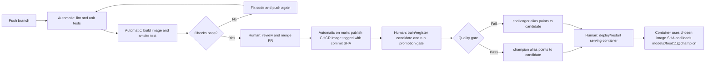

# Lab 5 - CI/CD with GitHub Actions

## Question 1

A unit test that loads the real MLflow model depends on external state and services, so it can fail even when the code under test is correct. The MLflow server may be unavailable or unreachable, and the `champion` alias or its artifact may be missing. Loading a large model also makes tests slower and less deterministic. The fake model keeps this test focused on the API's request handling and response format.

## Question 2

The API test proves that the endpoint accepts an uploaded image, calls the injected model, and returns JSON with the expected category and a confidence between 0 and 1 for the fake model's fixed output. It does not measure real model accuracy, prove that MLflow can load a model, or show that predictions generalize to unseen food images.

## Question 3

The cross-split duplicate check catches identical file content by hash. A duplicate can leak examples between training and evaluation and make test accuracy look better than performance on genuinely unseen images, while a corrupted image usually causes an immediate, visible decoding error. The validator's synthetic test passed on a clean dataset and failed after I copied a training image into evaluation. The original DVC dataset contained 611 cross-split duplicates in the full data and 43 in the mini derivative. I updated preprocessing to retain the first occurrence in training/validation/evaluation order, regenerated the derived data locally, and verified that both datasets pass all five contract checks.

## Question 4

After `dvc pull`, run `data.py` to regenerate the deduplicated derived splits, then run `validate_data.py` before training. Run the validator again in the data-preparation or model-release pipeline where the DVC remote is available, before evaluating or registering a model. GitHub-hosted CI cannot validate data it cannot access. The raw images remain DVC-tracked; the cleaned processed splits are reproducibly derived from them by `data.py`.

## Question 5

If a test fails, the `smoke` job is skipped because it has `needs: test`. Without that dependency, smoke could run independently, wasting time and potentially succeeding even though the unit-test gate failed.

## Question 6

The first successful run (workflow run 2) took 5m58s. The empty-commit run (workflow run 3) took 2m29s. The `docker/build-push-action` step was the clearest improvement: 3m16s on run 2 and 7s on run 3, because BuildKit restored its GitHub Actions layer cache. The `uv sync` step took 4s in both runs; the test job dropped from 24s to 21s.

## Question 7

A commit-SHA tag identifies the exact code used to build an image and can be rolled back or reproduced. With `latest`, machine A could pull it before a new push and keep running the previous image, while machine B pulls afterward and runs the new image; both would claim to run `latest` while running different code.

## Question 8

The publishing job grants only read access to repository contents and write access to packages. If a compromised step received a broadly write-enabled token, it could modify repository contents, publish releases, or alter other resources permitted by that token, expanding the impact beyond publishing the image.

## Question 9

The demonstration PR showed `test` failing and `smoke` skipped because it depends on `test`; the required checks blocked merging. After I fixed the category mapping and pushed again, both `test` and `smoke` passed and merging became available. The main-only image-publishing job was skipped on the feature branch. Compared with relying on each developer to remember local tests, required checks apply the same merge gate to every contributor.

## Question 10

The original champion (version 2) had no test metric or dataset parameter, so I evaluated it and both candidates on the same deduplicated mini evaluation split (`n=1,096`) and registered the evaluation runs. The baseline was registered as version 5 and set as `champion`, with `test_accuracy=0.8102`. Candidate version 3 (`lr=1e-8`) was reevaluated as version 6 at `0.1095`; candidate version 4 (`lr=1e-4`) was reevaluated as version 7 at `0.7573`. For the champion accuracy `p=0.8102`, `2 * se = 2 * sqrt(p * (1-p) / 1096) = 0.0237`, or 2.37 percentage points. Both candidates were below `0.8102 + 0.0237 = 0.8339`, so the gate tagged both `challenger` and left `champion` at version 5. The challenger alias now points to version 7; both versions retain their own decision and accuracy tags.

## Question 11

One option is to use a hosted tracking server such as DagsHub and trigger a workflow after model registration, giving the runner an authenticated route to MLflow. Another is to use a self-hosted GitHub Actions runner in the same private network as the MLflow server, then trigger the promotion job after training.

## Question 12

The code version is chosen by the commit whose SHA tags the published image. The model version is chosen independently by the MLflow `champion` alias when the promotion gate accepts a candidate. The workflow publishes an image but does not deploy or restart the Compose service.