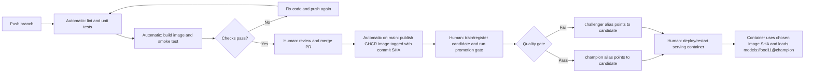

# Lab 5 - CI/CD with GitHub Actions

## Question 1

A unit test that loads the real MLflow model depends on external state and services, so it can fail even when the code under test is correct. The MLflow server may be unavailable or unreachable, and the `champion` alias or its artifact may be missing. Loading a large model also makes tests slower and less deterministic. The fake model keeps this test focused on the API's request handling and response format.

## Question 2

The API test proves that the endpoint accepts an uploaded image, calls the injected model, and returns JSON with the expected category and a confidence between 0 and 1 for the fake model's fixed output. It does not measure real model accuracy, prove that MLflow can load a model, or show that predictions generalize to unseen food images.

## Question 3

The cross-split duplicate check catches identical file content by hash. A duplicate can leak examples between training and evaluation and make test accuracy look better than performance on genuinely unseen images, while a corrupted image usually causes an immediate, visible decoding error. The validator's synthetic test passed on a clean dataset and failed after I copied a training image into evaluation. The existing mini dataset also contains 43 cross-split duplicates, so its validation correctly fails before any additional copy is made.

## Question 4

Run `validate_data.py` in the local or training environment after `dvc pull` and before training. Run it again in the data-preparation or model-release pipeline where the DVC remote is available, before evaluating or registering a model. GitHub-hosted CI cannot validate data it cannot access.

## Question 5

If a test fails, the `smoke` job is skipped because it has `needs: test`. Without that dependency, smoke could run independently, wasting time and potentially succeeding even though the unit-test gate failed.

## Question 6

The first successful run (workflow run 2) took 5m58s. The empty-commit run (workflow run 3) took 2m29s. The `docker/build-push-action` step was the clearest improvement: 3m16s on run 2 and 7s on run 3, because BuildKit restored its GitHub Actions layer cache. The `uv sync` step took 4s in both runs; the test job dropped from 24s to 21s.

## Question 7

A commit-SHA tag identifies the exact code used to build an image and can be rolled back or reproduced. With `latest`, machine A could pull it before a new push and keep running the previous image, while machine B pulls afterward and runs the new image; both would claim to run `latest` while running different code.

## Question 8

The publishing job grants only read access to repository contents and write access to packages. If a compromised step received a broadly write-enabled token, it could modify repository contents, publish releases, or alter other resources permitted by that token, expanding the impact beyond publishing the image.

## Question 9

After branch protection is enabled, the pull request should show the `test` and `smoke` checks, and a deliberately broken test should be red. A required failing check prevents merging until it passes. I have not configured the repository's branch protection or opened the demonstration pull request yet; those settings require repository-owner access. Compared with relying on each developer to remember local tests, required checks apply the same merge gate to every contributor.

## Question 10

I trained and registered two mini-dataset candidates. Version 3 (`lr=1e-8`) logged `test_accuracy=0.1122`; version 4 (`lr=1e-4`) logged `test_accuracy=0.7655`. The current `champion` is version 2, whose source run only has `val_accuracy=0.7783` and lacks both `test_accuracy` and the `dataset` parameter. The promotion script therefore rejected both comparisons and left `champion` unchanged; no gate decisions or candidate tags were written. The mini evaluation split has 1,096 images (the full split has 3,347). For scale only, using version 4's accuracy as a hypothetical baseline gives `2 * sqrt(0.7655 * (1 - 0.7655) / 1096) = 0.0256`, or 2.56 percentage points. This is not a valid champion threshold; a champion run with test accuracy and dataset metadata is needed for the actual gate.

## Question 11

One option is to use a hosted tracking server such as DagsHub and trigger a workflow after model registration, giving the runner an authenticated route to MLflow. Another is to use a self-hosted GitHub Actions runner in the same private network as the MLflow server, then trigger the promotion job after training.

## Question 12

The code version is chosen by the commit whose SHA tags the published image. The model version is chosen independently by the MLflow `champion` alias when the promotion gate accepts a candidate. The workflow publishes an image but does not deploy or restart the Compose service.